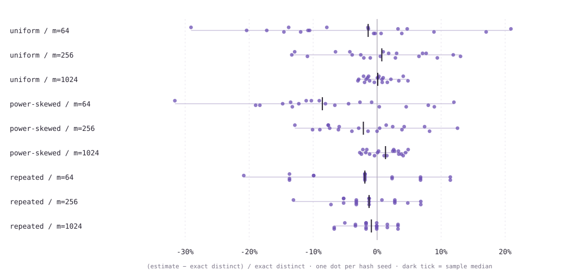

# Streaming sketches lab

Two bounded TypeScript streaming algorithms, evaluated against exact counts: **HyperLogLog** for distinct cardinality and **Count-Min** for point frequencies. The repository contains fixed synthetic streams, exact references, every repeated-seed estimate, raw query samples, payload accounting, portable snapshots, merge checks, tests and a report centered on observed error distributions.

**[Technical report](docs/report.html)** · [Screenshots](docs/screenshots/README.md) · [Review recording](docs/recordings/README.md) · [Algorithm and state specification](docs/specification.md)



## Recorded findings

The full experiment runs **180 HLL configurations and 180 Count-Min configurations**: three fixed streams × three sizes × twenty deterministic hash seeds. Each stream has 12,000 events.

| Stream | Exact distinct keys | Definition |
| --- | ---: | --- |
| Uniform | 3,863 | Seeded pseudo-uniform draws over 4,096 keys. |
| Power-skewed | 3,039 | `floor(U^4 × 4096)`, using a fixed seeded generator. This is not a fitted Zipf model. |
| Repeated | 64 | Fifty-event blocks cycling through 64 keys. |

- On the uniform stream, observed HLL relative RMSE drops from **12.75% at 64 registers** to **2.18% at 1,024 registers**. Individual seeded errors still vary; this is not a guaranteed bound.
- Count-Min records **zero underestimates across 417,960 present-key queries**. Its nonnegative update rule makes estimates upper bounds on represented counts as long as counters do not overflow.
- At width 1,024/depth 4, the uniform stream still has a **91.4% median positive-query rate on the 64 absent keys**. A positive frequency estimate does not prove membership.
- All **six recorded partition-merge state comparisons** match direct ingestion exactly. The tests cover additional configurations, seeds and merge cases.
- Fixed sketch arrays can exceed the exact logical payload for small key spaces. The repeated stream's exact reference is only 1,088 logical bytes; a 1,024-wide, four-row Count-Min array uses 16,384 payload bytes.

These conclusions concern the recorded synthetic streams and hash seeds. They are not production impact, a scalability guarantee, or a statistical claim about unseen workloads.

## Reproduce

Use **Node 24**. Runtime code uses Node built-ins; pinned TypeScript and Node typings supply strict static checks. No external service or credentials are required.

```sh
npm ci --ignore-scripts
npm run typecheck
npm test
npm run experiment -- --output results-local
```

The full experiment uses hash seeds 0–19. `--quick` uses seeds 0–1 for a smaller fresh check. CI runs strict checking, the full unit/evidence tests, and the quick experiment on Ubuntu. `results-local/` and `results-ci/` are ignored. The generator recreates the same `data/` files in either mode.

To replace the published measurements and render the report:

```sh
npm run experiment
npm run report
```

Generation, exact references, validation, error calculations and raw timings are executable. Report generation reads recorded artifacts; it does not fabricate points or rerun the timed experiments.

## CLI

```sh
npm run cli -- --help
npm run cli -- hll data/uniform.txt 8 0
npm run cli -- count-min data/uniform.txt 256 4 0
npm run cli -- estimate results/snapshots/uniform-hll.json
npm run cli -- estimate results/snapshots/uniform-count-min.json key-0000
npm run cli -- merge results/snapshots/uniform-hll.json results/snapshots/repeated-hll.json
```

Creation and merge commands print a canonical JSON snapshot. Estimate commands print the result as JSON. Argument, configuration, state or overflow errors exit with status 2 and a concise message. CLI inputs are LF-separated UTF-8 keys with terminal LF; a zero-byte file represents an empty stream. The CLI has a 16 MiB input-file bound. The library supports valid UTF-8 keys up to 256 bytes, including empty keys, but the CLI's line framing cannot represent an embedded LF inside a key.

The last example forms the distinct-key union of two HLL snapshots with matching precision/seed. Count-Min merging instead sums represented observations, so overlapping streams are counted again. Neither command tracks source IDs or detects duplicate partition delivery.

## HyperLogLog implementation

An HLL sketch has `m = 2^p` byte registers, with `4 ≤ p ≤ 12`. Each key is hashed to a deterministic 64-bit SHA-256 prefix. Its high `p` bits select a register. The remaining suffix contributes one plus its leading-zero count, or `64 - p + 1` for an all-zero suffix. A register keeps its maximum observed rank.

The raw estimate is `alpha(m) × m² / sum(2^-register)`. The implementation uses the classical constants for 16, 32 and 64 registers and the usual approximation for larger arrays. When the raw estimate is at most `2.5m` and `V > 0` empty registers remain, it uses linear counting, `m × ln(m/V)`. This gives zero for an empty sketch. All repeated-stream runs use that small-range correction; the two larger-distinct streams use the raw estimator in this experiment.

The implementation is a bounded HLL-style estimator using **64-bit hashes**, not HLL++. It has no sparse representation, bias tables, precision conversion, deletions, or finite-hash large-range correction. Very large cardinalities approaching the hash space are outside its evaluated scope. A restored structurally valid register array is not proof that a real stream produced it.

The often cited asymptotic relative standard error of about `1.04 / sqrt(m)` comes from idealized hash assumptions and asymptotic analysis. It is not a deterministic error bound, a confidence interval for these twenty seeds, or a promise that every run stays near it. The report plots every observed signed error and shows sample ranges rather than invented intervals.

## Count-Min implementation

Count-Min stores a `depth × width` array of uint32 counters. Width is a power of two from 16 through 4,096; depth is 2–8. Each row independently domain-separates its SHA-256 input and maps the resulting 64-bit value modulo width. An update adds the same nonnegative integer weight to one counter in each row. A query returns the minimum of those row counters.

Weights and total represented mass are bounded by `2^32 - 1`. Updates and merges preflight overflow before mutating counters; they reject instead of wrapping or saturating. Every row sum equals the total. Serialized state validation checks that invariant. Zero-weight updates are allowed; negative and fractional weights are rejected.

For an actually represented nonnegative stream, each queried counter contains the key's true count plus collision mass. Taking the minimum therefore cannot underestimate, regardless of the quality of the hash functions. This structural fact does **not** imply a tight upper error bound. Positive estimates for absent keys are possible; under these assumptions an exact zero does imply zero represented count.

The original probability analysis uses appropriately sampled pairwise-independent hash families, with independent row selection, to relate width/depth to additive error and failure probability. This code uses deterministic seeded SHA-256 domains. It does **not** prove that this family satisfies those assumptions or claim the paper's ε/δ guarantee. Its error results are empirical. Public deterministic seeds also provide no adversarial-input protection.

The sketch cannot enumerate keys or discover candidate heavy hitters by itself. It only answers frequency queries for keys supplied by the caller. Negative updates, conservative updating, decay and deletion are not implemented.

## Hashing and key identity

The exact hash input is an algorithm-specific ASCII domain with a terminal zero byte, followed by a four-byte big-endian seed, a four-byte big-endian row number, and the key's UTF-8 bytes. HLL always uses row zero. Count-Min uses a distinct row number for each row. The first eight digest bytes are interpreted as a big-endian unsigned integer.

Seeds are integers from 0 through `2^32 - 1`. Keys must round-trip through UTF-8 without replacement; unpaired surrogate strings are rejected. No case folding, trimming or Unicode normalization occurs, so composed and decomposed forms are separate keys. The dataset generator's seeds are separate from sketch hash seeds.

All configurations for a given seed use the same underlying algorithm hash layout. Errors across sizes are therefore paired, not independent replications. The twenty seeds are deterministic evaluation points on fixed streams, not a claim of twenty independent population samples.

## Merge and serialization contract

| Behavior | HLL | Count-Min |
| --- | --- | --- |
| Merge operation | Register-wise maximum | Counter-wise sum, plus total |
| Required equality | Precision, hash seed, algorithm version | Width, depth, hash seed, algorithm version |
| Merge same state twice | Idempotent | Counts represented observations twice |
| Configuration mismatch | Throws before mutation | Throws before mutation |
| Overflow | Ranks bounded by 64-bit suffix | Rejects before mutation |

Public configuration is exposed through private-backed getters, so native JavaScript cannot silently change a seed or dimension after allocation. Snapshots contain copied base64 payloads. Restore validates before constructing the live sketch.

Canonical JSON has fixed field order, version, algorithm and hash identity. HLL payloads are one byte per register. Count-Min serializes each uint32 counter explicitly little-endian, independent of host memory endianness. The decoder accepts at most 200,000 bytes, verifies UTF-8, validates dimensions/payload length/rank or row sums, and reconstructs the exact canonical representation. It rejects duplicate keys, noncanonical base64, unknown fields or versions, negative zero, alternate number spelling, BOMs, and whitespace except one terminal LF.

These are structural checks, not authentication. An attacker can alter a snapshot while preserving its structural invariants. No signature, MAC, provenance verification or source-deduplication mechanism is implemented.

## Experiment method and error denominators

Each fixed stream is replayed completely for each configuration and seed. HLL precisions are 6, 8, and 10; Count-Min widths are 64, 256, and 1,024 with depth 4. Configuration order rotates with seed. The data generator is a specified 32-bit LCG with a fixed seed for the first two streams; the repeated stream has no random choices. Generated stream bytes and their SHA-256 values are committed.

HLL error is `(estimate - exact distinct) / exact distinct`. RMSE is the square root of the mean squared relative errors across the twenty seeds. Absolute-error p95 uses linearly interpolated sample quantiles. These summaries are descriptive, not inferential confidence statements.

For Count-Min, every present key is queried, plus 64 fixed absent keys. Mean and p95 overcount are calculated over **present keys with equal weight per key**, not weighted by event frequency. The normalized version divides by the stream's 12,000 total events; it is not relative error divided by the queried key's count. Raw panel rows include up to 64 evenly spaced present keys, the eight most frequent keys, and 64 absent keys, with duplicates removed. The exact panel is saved in the data manifest.

This distinction matters: uniform-stream keys average about three true events each, so even a few extra estimated events can be a large relative error for that key. The report shows absolute overcounts and absent-query behavior alongside normalized aggregates.

For recorded merge evidence, seed zero at HLL precision 8 and Count-Min width 256/depth 4 is split by event index modulo four, then merged in order 2, 0, 3, 1. Each merged portable state must equal direct ingestion. Unit tests repeat partition merging over four seeds and three size configurations.

## Timing and memory accounting

Per-run update timings use `performance.now` around the complete update loop, including key validation, UTF-8 conversion, SHA-256 hashing, and register/counter operations. Exact-reference construction, input generation, query work, snapshot encoding and disk writes are outside update timing. Count-Min has a separate query timer for all present and absent queries. Timing samples vary with hash seed and execution conditions; there is no isolated hash benchmark, cache-flush protocol, warmup guarantee or production throughput claim.

HLL reports one byte per register from its typed array. Count-Min reports four bytes per counter. These payload figures exclude objects, configuration, hash buffers, runtime allocations and the process heap. Exact logical payload counts UTF-8 bytes of distinct keys plus eight bytes per exact numeric count; it also excludes Map/string/object overhead. Compact exact JSON and portable sketch JSON sizes are reported separately. None of these numbers is a measurement of JavaScript heap savings.

## Inspect the evidence

| Artifact | Contents |
| --- | --- |
| [data/manifest.json](data/manifest.json) | Stream rules, data seeds, byte hashes, exact cardinalities, payload accounting and query panels. |
| [data/](data/) | Three complete event streams and three complete exact frequency dictionaries. |
| [results/hll-runs.csv](results/hll-runs.csv) | All 180 estimates, signed errors, correction modes, payload/snapshot sizes and update timings. |
| [results/count-min-runs.csv](results/count-min-runs.csv) | All 180 overcount summaries, absent behavior, memory counters and update/query timings. |
| [results/query-panel.csv](results/query-panel.csv) | All 23,940 raw panel estimates with exact counts. |
| [results/merge-checks.json](results/merge-checks.json) | Partition definitions, merge order and exact portable-state hashes. |
| [results/snapshots/](results/snapshots/) | Six usable seed-zero snapshots at the middle configuration. |
| [results/summary.json](results/summary.json) | Observed seed aggregates and validation counts. |
| [results/environment.json](results/environment.json) | Actual runtime/platform/timestamp and normalized experimental source hashes. |

Tests independently derive small bucket/rank vectors and little-endian counters, verify fixed multilingual SHA vectors calculated with Python `hashlib`, check analytic HLL estimates, cover exact uint32 boundaries, validate error arithmetic against the committed exact dictionaries, and test merge/serialization failure behavior. Evidence tests recompute stream and source hashes, count the committed streams independently, replay all six stored seed-zero snapshots from those inputs, compare their state hashes and raw rows, and reconcile run counts and seed aggregates to the published summary. These checks validate preserved evidence before CI generates a separate fresh experiment.

## Primary references

1. Philippe Flajolet, Éric Fusy, Olivier Gandouet, and Frédéric Meunier. **HyperLogLog: the analysis of a near-optimal cardinality estimation algorithm.** *2007 Conference on Analysis of Algorithms, DMTCS Proceedings AH*, pp. 127–146, 2007. [Original paper](https://algo.inria.fr/flajolet/Publications/FlFuGaMe07.pdf). This lab follows the register estimator and small-range correction while using a 64-bit hash domain and its own bounded state format.
2. Graham Cormode and S. Muthukrishnan. **An improved data stream summary: the count-min sketch and its applications.** *Journal of Algorithms* 55(1), pp. 58–75, 2005. DOI: [10.1016/j.jalgor.2003.12.001](https://doi.org/10.1016/j.jalgor.2003.12.001). [Paper](https://www.cs.yale.edu/homes/aspnes/pinewiki/attachments/DataStreamComputation/count-min.pdf). The paper's hashing assumptions are not asserted for this deterministic SHA-based implementation.

## Provenance and scope

This is **AI-assisted portfolio work** on owned synthetic datasets. Estimates, errors, exact reference counts, timings, payloads, merge states and charts were actually generated. Screenshots and recordings document review of this report; they do not represent historical manual work, production employment or business impact.

Source hashes normalize CRLF to LF. The environment artifact omits personal paths, usernames and hostnames. This lab provides bounded algorithm implementations and reproducible observations, not a production analytics service, distributed delivery protocol, cryptographic guarantee or universal accuracy promise.
